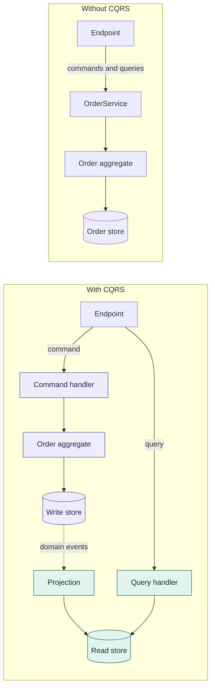

# DDD with and without CQRS, no MediatR

Two runnable C# examples built on the same `Order` domain (aggregate, value objects, domain events). Neither one uses MediatR.

| Project | Approach |
|---|---|
| [`DddWithCqrs`](DddWithCqrs/DddWithCqrs.cs) | DDD + CQRS: one handler per use case, a separate read model kept in sync by domain events, cross-cutting concerns as decorators |
| [`DddWithoutCqrs`](DddWithoutCqrs/DddWithoutCqrs.cs) | DDD with a classic application service: reads and writes share the aggregate and the repository |

Each example is a single self-contained file, with its layers split by namespace (`Shop.Domain`, `Shop.Application`, `Shop.Infrastructure`, `Shop.Api`). You can read it top to bottom, or paste it into [DotNetFiddle](https://dotnetfiddle.net) with a .NET 6+ compiler.

## Run

Open `DddCqrsWithoutMediatR.sln` in Visual Studio or Rider, or from the command line:

```bash
dotnet run --project DddWithCqrs
dotnet run --project DddWithoutCqrs
```

Targets .NET 8 and rolls forward to newer runtimes. No NuGet packages.

Both programs run the same scripted session against in-memory stores: create an order, add lines, read it, submit it, try to change it after submit (rejected with 409), create a second order, then list the customer's orders.

## The difference



With CQRS, writes (purple) and reads (teal) run in separate lanes. The only link between them is domain events: when an `Order` is saved, the projection turns its events into the `OrderSummary` rows that queries read. Query handlers never load the aggregate.

Without CQRS, commands and queries go through the same `OrderService`, aggregate and repository. Reads load the full aggregate and map it to a DTO, so the repository picks up query methods like `GetByCustomerAsync`.

## What replaces MediatR

| MediatR | In these examples |
|---|---|
| `IRequest` / `IRequestHandler<,>` | `ICommandHandler<TCommand>` and `IQueryHandler<TQuery, TResult>`, a few lines each |
| `IMediator.Send(...)` | The endpoint injects the exact handler it needs (or `IOrderService` without CQRS) |
| `IPipelineBehavior<,>` | A decorator: `LoggingCommandHandler<TCommand>` |
| `INotification` + `IPublisher.Publish` | `IDomainEventHandler<TEvent>` and a ~20-line `DomainEventDispatcher` |

Wiring a handler into an ASP.NET Core minimal API:

```csharp
app.MapPost("/orders/{id}/submit",
    (Guid id, ICommandHandler<SubmitOrder> handler, CancellationToken ct) =>
        handler.HandleAsync(new SubmitOrder(id), ct));
```

Registering handlers and decorators with `Microsoft.Extensions.DependencyInjection` and [Scrutor](https://github.com/khellang/Scrutor):

```csharp
services.Scan(s => s.FromAssemblyOf<CreateOrderHandler>()
    .AddClasses(c => c.AssignableTo(typeof(ICommandHandler<>))).AsImplementedInterfaces().WithScopedLifetime()
    .AddClasses(c => c.AssignableTo(typeof(IQueryHandler<,>))).AsImplementedInterfaces().WithScopedLifetime());

services.Decorate(typeof(ICommandHandler<>), typeof(LoggingCommandHandler<>));
```

## With vs without CQRS

The domain layer is identical in both files except for one repository method.

| | With CQRS | Without CQRS |
|---|---|---|
| Writes | Load the aggregate, call a method, save | Same |
| Reads | Query handlers read a flat `OrderSummary` built by a projection; they never load `Order` | `OrderService` loads whole aggregates and maps them to `OrderDto` |
| Repository | `GetByIdAsync` and `SaveAsync` only | Also `GetByCustomerAsync`: a read concern inside the write model |
| Code organization | One handler per use case | One service per aggregate |
| Cross-cutting concerns | One generic decorator covers every command | Inline, or a decorator that re-implements every service method |
| Creating an order | The caller generates the id; commands return nothing | `CreateAsync` returns the new id |
| Domain events | Feed the read model and side effects | Side effects only |

Rule of thumb: start without CQRS. Move to handlers plus a read model when reads and writes start pulling the model in different directions: lots of screen-shaped queries, different scaling needs, or a separate read store.

## Deliberate simplifications

These are teaching examples, so some production concerns are left out on purpose:

- Everything runs in memory. Domain events are dispatched in-process right after the save, so the read model updates immediately. In production you'd write them to an outbox in the same transaction, which makes the read model eventually consistent.
- Dependencies are wired by hand in `Main` (the composition root), so each file runs without any packages.
- The client sends unit prices. A real system would look them up in a catalog.

## Sample output

With CQRS. The `[cmd]` lines come from the logging decorator:

```text
DDD + CQRS, no MediatR

> POST /orders  alice, EUR
   [cmd] CreateOrder ok (11.10 ms)
   -> 201 Created 8dc7b470

> POST /orders/8dc7b470/lines  BOOK-DDD x1 @ 45.00
   [cmd] AddOrderLine ok (7.11 ms)

> POST /orders/8dc7b470/lines  MUG x2 @ 12.50
   [cmd] AddOrderLine ok (0.11 ms)

> GET  /orders/8dc7b470
   -> 8dc7b470  Draft      items: 3  total: 70.00 EUR

> POST /orders/8dc7b470/submit
   [event] OrderSubmitted -> confirmation email to alice (70.00 EUR)
   [cmd] SubmitOrder ok (4.98 ms)

> POST /orders/8dc7b470/lines  MUG x1 @ 12.50  (after submit)
   [cmd] AddOrderLine rejected (DomainException)
   -> 409 Conflict: Order 8dc7b470 is Submitted and can no longer change.

> POST /orders  alice, EUR
   [cmd] CreateOrder ok (0.03 ms)
   -> 201 Created 20571b0c

> POST /orders/20571b0c/lines  MUG x1 @ 12.50
   [cmd] AddOrderLine ok (0.03 ms)

> GET  /customers/alice/orders
   -> 8dc7b470  Submitted  items: 3  total: 70.00 EUR
   -> 20571b0c  Draft      items: 1  total: 12.50 EUR
```

The version without CQRS prints the same responses, minus the `[cmd]` lines.
